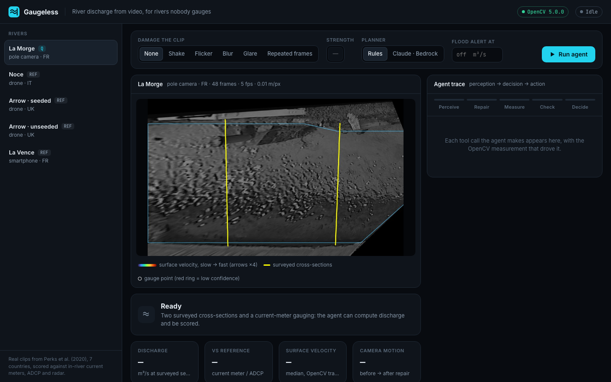
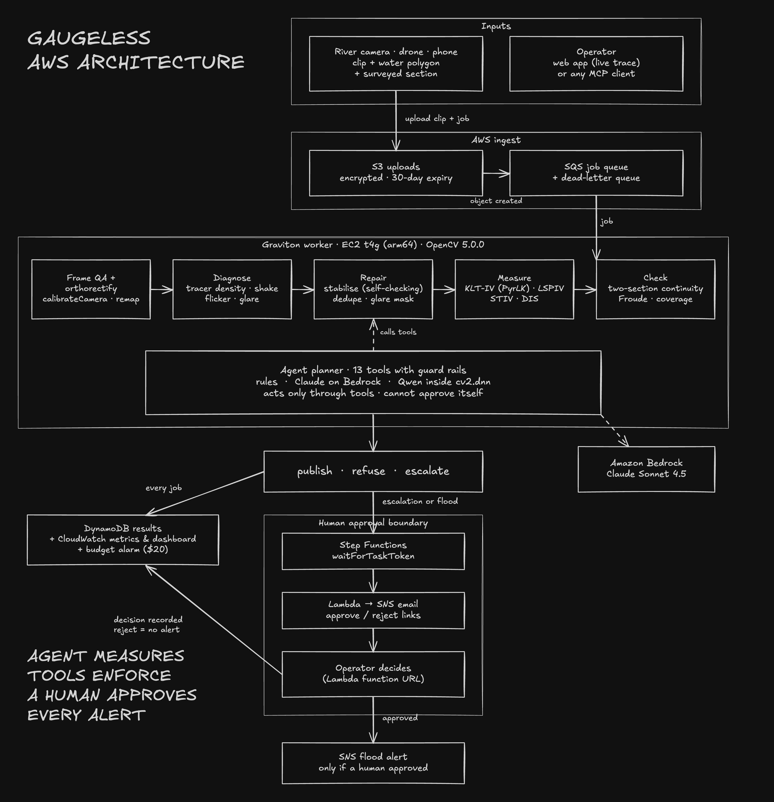

# Gaugeless: River Discharge from Video, for Rivers Nobody Gauges

> An agent built on **OpenCV 5** that diagnoses a river clip, repairs what it can (camera shake, re-encoded
> frame rates, flicker, glare), measures surface velocity, and turns it into **discharge in m³/s** at surveyed
> cross-sections. It checks the physics, and it **refuses or asks a human** when the number can't be
> trusted.

Built for the **[OpenCV AI Competition 2026](https://opencv26.devpost.com/)**.

---

## Live

- 🌐 **Live demo**: http://100.63.108.38/ (a small AWS Graviton server, so a run takes about a minute)
- 🎥 **Demo video**: https://youtu.be/o9ElAowYNU0
- 📄 **Technical report**: [`REPORT.md`](REPORT.md)
- 🗺️ **Architecture**: [`docs/architecture.png`](docs/architecture.png)

---

## Table of Contents

- [Quick Path](#quick-path)
- [Why It Stands Out](#why-it-stands-out)
- [Results](#results)
- [What it does](#what-it-does)
- [Architecture](#architecture)
- [COOL on Graviton](#cool-on-graviton)
- [Requirements](#requirements)
- [Setup](#setup)
- [Usage](#usage)
  - [The agent from the command line](#the-agent-from-the-command-line)
  - [The web app](#the-web-app)
  - [MCP server](#mcp-server)
  - [Claude on Amazon Bedrock](#claude-on-amazon-bedrock)
  - [Deploy to AWS](#deploy-to-aws)
- [Honest limits](#honest-limits)
- [Project layout](#project-layout)
- [AI assistance](#ai-assistance)

---

## Quick Path

The shortest way through the project:

```bash
python3.12 -m venv .venv && .venv/bin/pip install -r requirements.txt
make test                                    # 25 tests, synthetic, no dataset needed
python -m gaugeless.web.server --port 8080   # then open http://localhost:8080
```

Or skip the install and open the **[live demo](http://100.63.108.38/)**:
1. Pick **La Morge**.
2. Set **Shake** at the highest strength.
3. Press **Run agent**.

You'll see the agent:
1. Notice the shake.
2. Stabilise the clip and check its own repair.
3. Measure the flow, then check the two cross-sections against each other.
4. Publish **1.316 m³/s**. The current-meter gauging says 1.321.

## Why It Stands Out

Most of the world's rivers have no gauge. A phone, a drone or a fixed camera can measure them, but only if
someone can tell a good measurement from a confident wrong one. Gaugeless automates that judgement.

- **It refuses instead of guessing.** On a clip with nothing to track, every velocimetry method returns a
  confident near-zero speed (−95 to −100% error). Gaugeless measures tracer density first and refuses, with
  advice to seed the surface.
- **It repairs footage and then checks the repair.** Stabilisation, frame de-duplication, glare masks and
  background subtraction each check that they helped. If a repair didn't help, the tool undoes it.
- **It checks physics that needs no reference.** It compares discharge at two cross-sections (continuity) and
  checks the Froude number and coverage. These catch wrong numbers when no gauge exists to compare against.
- **Guard rails live in the tools, not the prompt.** Planners act only through 13 tools. The tools won't
  measure an untrackable surface, won't publish a failed discharge, and won't send a flood alert without a
  human's approval.

The result on 105 damaged real clips:

```text
fixed pipeline: 24 silent failures   (published, >40% error, no warning)
Gaugeless:       0 silent failures
```

## Results

Data: Perks et al. (2020), *Towards harmonisation of image velocimetry techniques for river surface velocity
observations*, ESSD 12:1545 (CC0). It has 14 sites in 7 countries, with current-meter, ADCP and radar
references.

**Discharge from video** (rules agent, α = 0.85, not fitted to any site):

| Site | Camera | Agent Q (m³/s) | Reference Q (m³/s) | Error |
|---|---|---|---|---|
| La Morge (FR) | pole camera | 1.316 | 1.321, current-meter gauging | **−0.4%** |
| Thalhofen (DE) | fixed camera | 52.92 | 52.38, ADCP transect | **+1.0%** |
| Murg (CH) | drone, 4K | 2.854 | 2.76, stated with the ADCP data | **+3.4%** |
| La Vence (FR) | smartphone | 1.058 | 1.179, ADCP transect | **−10.2%** |
| Castor (CA) | bridge camera, **raw oblique video** | 25.5 | 29.6, ADCP transect | **−13.8%** |

Gaugeless orthorectifies Castor itself, from the raw video:
- A camera solve from 12 ground control points, with a radial lens term: 2.6 px RMS. In a leave-one-out
  check the held-out point lands within 2.5 px (median), against 16 px for a plain pinhole model.
- One `cv2.remap` per frame (4 ms).

For Thalhofen and La Vence, the reference Q is integrated from the ADCP verticals. The agent uses only the
ADCP depths and positions, never its velocities.

**Agent vs a fixed pipeline on damaged real clips.** That's 105 runs: 7 rivers × {clean, shake ×3, flicker ×3,
blur ×3, glare ×3, repeated frames ×2}.

| | Fixed pipeline | Agent |
|---|---|---|
| Silent failures (published, >40% error, 15+ points worse than the undamaged clip) | **24** | **0** |
| More accurate than the other, on the same points | — | 45 runs (56 equal within 2 points, 4 worse) |
| Escalated to a human instead of publishing | never | 3 (heavy glare: discharge checks failed) |

| What | Result |
|---|---|
| Unseeded clips (no tracers) | **refused**; fixed pipelines return near-zero speeds with no warning |
| Camera shake (5 px) | fixed pipeline 115–208% error → agent 11–24% after self-checked stabilisation |
| Re-encoded frame rate (each frame ×2) | fixed pipeline +103 to +123% → agent unchanged from clean |
| Two-section continuity check | flags LSPIV on La Morge (39% disagreement) while passing KLT |
| Noce (drone, no damage added) | 22.7% → 14.4%: the agent finds 7 px of camera drift and removes it |

Every number has a command; see [Usage](#usage) and [`REPORT.md`](REPORT.md).

## What it does

```text
clip ─► frame QA ─► diagnose ─► repair ─► measure ─► check ─► publish | refuse | escalate to a human
         size,        tracer      stabilise   KLT (PyrLK +   continuity
         repeated     density,    (bank       KLT-IV         between two
         frames       motion,     RANSAC,     filters),      sections,
                      flicker,    self-       LSPIV, STIV,   Froude,
                      glare,      checking),  DIS            coverage
                      camera      dedupe,                    floor,
                      motion      glare mask,                per-point
                                  background                 confidence
```

- **Four velocimetry methods, all OpenCV 5:**
  - KLT: `calcOpticalFlowPyrLK` with forward-backward and KLT-IV filters.
  - LSPIV: `matchTemplate`.
  - STIV: space-time images with an FFT.
  - Dense flow: `DISOpticalFlow`.
- **Orthorectification:** a camera solve with lens distortion, projection onto the water plane at the recorded
  stage, then `cv2.remap`.
- **Repairs that check themselves:**
  - Bank-based stabilisation (feature matching plus RANSAC) and flow-based stabilisation for clips with no bank
    in view.
  - Frame de-duplication, glare masking and background subtraction.
- **Discharge:** depth-averaged velocity (α = 0.85) integrated over surveyed cross-sections. Before anything is
  published, the two sections are checked against each other, along with the Froude number and coverage.
- **Three planners, same tools:**
  - `rules`: deterministic. Every branch is tied to a measurement in [`plan.md`](plan.md).
  - `claude`: Claude Sonnet 4.5 on Amazon Bedrock, with tool use. It made the same publish/refuse decision as the
    rules planner on 14 of 14 rivers, with no site-specific code.
  - `local`: Qwen2.5-0.5B running inside **OpenCV 5's own DNN engine** (`cv2.dnn` + `cv2.dnn.Tokenizer`), for
    offline field reports.
- **Human in the loop:** escalations and flood alerts wait for an operator. Neither the agent nor the MCP server
  has an approve tool.

## Architecture



On AWS (`infra/gaugeless.yaml`, one CloudFormation stack):

```text
video ─► S3 ─► SQS ─► Graviton worker (OpenCV 5, or COOL) ─► DynamoDB
                           │
                           ├─► Claude on Bedrock (planner)
                           └─► escalation / flood alert ─► Step Functions (waits for a human)
                                                               └─► approve ─► SNS alert
CloudWatch: ms/frame, agent outcomes        Web app on the same worker: http://<WebIp>/
```

Live run on AWS (Oct 20):
- La Morge reproduced −0.4% on the Graviton worker.
- The unseeded clip was refused.
- Two flood-threshold jobs waited for a human. One was rejected (no alert sent) and one was approved (alert
  sent). Both are recorded in DynamoDB.

## COOL on Graviton

We ran the same code on one **c7g.large (Graviton3)** with two builds of OpenCV:
- **Stock:** OpenCV 5.0.0 from pip.
- **COOL:** the Cloud-Optimized OpenCV Library AMI (`ami-0c0803594d6330678`). That's OpenCV 4.12.0 built with
  `-mcpu=neoverse-v1`, LTO, TBB and KleidiCV.

The runs were interleaved (stock, COOL, COOL, stock), with 5 repeats each, on 4 rivers. Each figure is the median.

| Stage | Speed-up with COOL (geometric mean) |
|---|---|
| **Agent, end to end** | **1.16×** (La Morge 29.2 s → 25.1 s; Noce 43.9 s → 38.2 s) |
| KLT tracking (`calcOpticalFlowPyrLK`) | **1.18×** |
| Stabilisation | 1.10× |
| DIS dense flow | 0.99× |
| LSPIV (`matchTemplate`) | 0.97× |
| STIV | 0.75× (slower) |

- **Decisions:** the same on all 5 test clips under both builds: 4 published, the unseeded clip refused.
- **Discharge:** La Morge is identical (1.3158 m³/s). La Vence differs by 0.06%.
- **Tests:** all 25 pass under COOL.
- **One accuracy difference:** Noce's surface error is 14.4% on OpenCV 5 and 17.0% on COOL. The KLT tracker's
  output differs between versions.

**Caveat:** COOL ships OpenCV 4.12 and our pipeline targets OpenCV 5.0. So the speed-up mixes the effect of
COOL's build with the version difference. The [AWS](#deploy-to-aws) worker and the live demo run stock OpenCV 5.

Reproduce: `python -m bench.compare --stock results/cool/bench_stock_*.json --cool results/cool/bench_cool_*.json`.
Raw results are in [`results/cool/`](results/cool/).

## Requirements

- Python 3.12
- OpenCV 5 (`opencv-contrib-python-headless==5.0.0.93`, from `requirements.txt`)
- For the real-river results and the web app: the Perks et al. dataset (33 GB). The tests don't need it.
- Optional: AWS credentials with Bedrock access (Claude planner) and permission to deploy CloudFormation.

## Setup

```bash
python3.12 -m venv .venv
.venv/bin/pip install -r requirements.txt
make test
```

To get the dataset:
1. Download the archive from <https://doi.org/10.4121/uuid:014d56f7-06dd-49ad-a48c-2282ab10428e>.
2. Put the site folders under `data/perks/`.
3. Check every file against `data/perks/MANIFEST.tsv`:

```bash
python -c "from gaugeless.cases import verify_downloads as v; print(v())"
```

## Usage

### The agent from the command line

```bash
python -m gaugeless.discharge                                  # La Morge: video -> m³/s at both sections
python -m gaugeless.agent.run lamorge noce arrow_uas_unseeded  # rules planner, prints every decision
python -m gaugeless.agent.degrade_eval                         # agent vs fixed pipeline on damaged clips
python -m gaugeless.agent.summarise results/degrade.jsonl
make eval                                                      # tests + baseline + agent + degradations
```

### The web app

```bash
python -m gaugeless.web.server --port 8080
```

1. Pick a river.
2. Optionally damage the clip (shake, flicker, blur, glare, repeated frames).
3. Choose a planner, and set a flood threshold if you want an alert.

Each tool call streams in next to the velocity overlay. With the Claude planner, its reasoning streams in too.
Escalations stop at **Approve** / **Reject** for the operator. `--public` limits the server to one run at a time
and caps Claude runs per hour; the live demo runs with it.

### MCP server

```bash
python -m gaugeless.mcp_server
```

This exposes the same 13 tools to any MCP client (Claude Desktop, Claude Code, Cursor). There's no `approve` tool,
so an agent can't approve its own flood alert.

### Claude on Amazon Bedrock

```bash
python -m gaugeless.agent.run lamorge --planner claude
```

This uses the Bedrock Converse API with tool use (`GAUGELESS_MODEL`, default Claude Sonnet 4.5). The same guard
rails apply: once, Claude tried to publish without measuring the gauge points. The tool refused, and that check
is now a permanent guard rail with a test. These are live Bedrock calls, so they may incur charges.

### Deploy to AWS

```bash
make deploy EMAIL=you@example.com     # CloudFormation stack: S3, SQS, Graviton worker, DynamoDB, Step Functions, SNS
make upload-code upload-demo-data
make submit-demo                      # queue a dataset site as a job
make web-up                           # public web app on the worker, port 80 (stack output WebUrl)
```

## Honest limits

- **Tiber (flood, radar reference):** all four methods agree on 1.2–1.3 m/s, against the radar's 2.33 m/s. We
  report this as unresolved and haven't tuned toward it.
- **Oblique GoPro footage (Arrow)** stays at about 41% error: the far field is under-resolved after
  orthorectification.
- **Blur** is detected but not repaired. It raises error moderately, to 21–32%.
- **Discharge needs a surveyed cross-section.** Without one, Gaugeless reports surface velocity only.
- **Small local models can't plan this.** Qwen2.5 0.5B and 1.5B run inside OpenCV 5's DNN engine at 14–22
  tokens/s on a laptop CPU. But they choose the right repair in only 1–3 of 6 scenarios, and they miss "refuse
  an unseeded clip". So the local model writes offline field reports, and Claude on Bedrock plans.
- **One dataset:** 14 short clips from 7 countries, with no night or rain footage. The damage in the
  agent-vs-pipeline test is simulated on real clips.

## Project layout

```text
gaugeless/
  methods.py          # KLT, LSPIV, STIV, DIS velocimetry
  ortho.py            # camera solve, lens model, water-plane remap
  diagnose.py         # tracer density, camera motion, flicker, glare, repeated frames
  discharge.py        # cross-sections, alpha, continuity and Froude checks
  degrade.py          # controlled damage: shake, flicker, blur, glare, repeated frames
  agent/
    tools.py          # the 13 tools and their guard rails
    rules.py          # deterministic planner
    llm.py            # Claude on Bedrock planner (Converse + tool use)
    local.py          # Qwen in cv2.dnn
    run.py            # run and score the agent
  mcp_server.py       # the same tools over MCP
  worker.py           # SQS worker on Graviton
  web/                # dashboard (stdlib server + Server-Sent Events)
bench/                # timing benchmark and stock-vs-COOL comparison
infra/                # CloudFormation stack and web deploy script
tests/                # 25 synthetic tests
results/              # every number in this README, as JSONL
docs/                 # architecture diagram and screenshots
REPORT.md             # technical report
plan.md               # research log: what was measured and why each rule exists
```

## AI assistance

Gaugeless was designed and built with help from **Claude Code**. The agent's `claude` planner runs **Claude
Sonnet 4.5 on Amazon Bedrock**. This disclosure is here for the competition rules.
